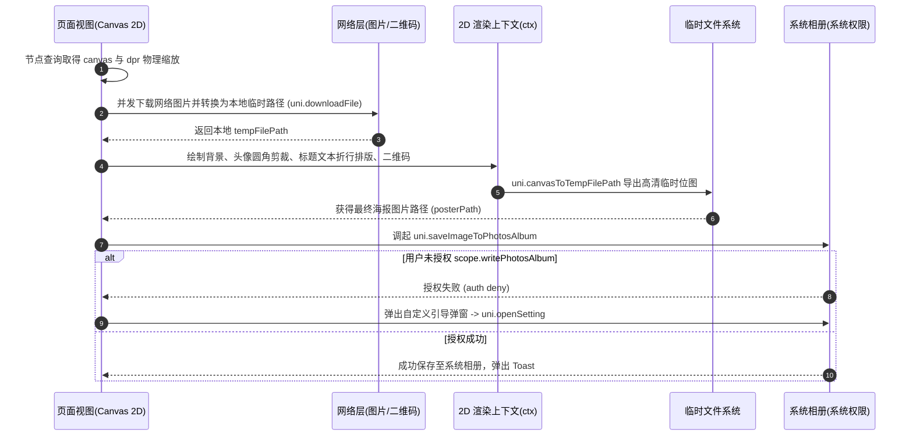
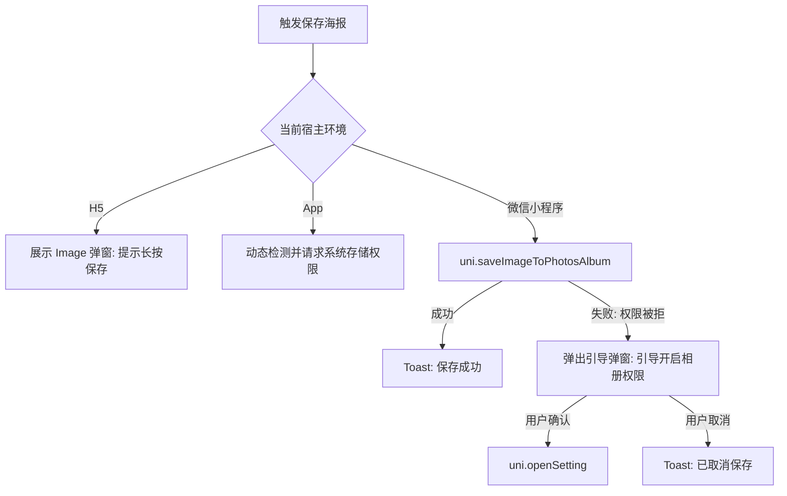

# 高级-跨端Canvas2D动态海报绘制与离屏光栅化导出

在电商分销裂变、打卡签到以及运营拉新等移动端核心业务中，前端动态生成分享海报（包含用户动态头像、营销二维码、富文本标题与价格标签）是一项极其常见且事故高发的高级功能。本文深度拆解 Uni-App 体系下**新版 Canvas 2D 渲染管线**、**多倍屏抗锯齿物理推导**、**长文本自动换行与布局算法**，以及**跨端离屏图片导出与相册权限闭环治理**。

---

## 一、核心底层机制与全景架构

### 1.1 Canvas 2D 对比传统 Context 架构演进

微信小程序及新版 Uni-App 全面废弃了传统的 `CanvasContext`（旧版依赖 JSON 绘制指令跨线程序列化同步到 Native 离屏渲染），转向基于 Web 标准的 **Canvas 2D 接口**：

```mermaid
graph TD
    subgraph 旧版传统 Canvas (已废弃/性能低下)
        A1[JS逻辑层执行绘制指令] -->|draw 调用| B1[序列化为巨大 JSON 指令数组]
        B1 -->|跨线程 IPC 通信| C1[视图层 / Native 渲染组件]
        C1 -->|解析 JSON 指令并光栅化| D1[屏幕显示 / 内存开销暴增]
    end

    subgraph 新版 Canvas 2D (推荐/高性能规范)
        A2[节点查询获取 Node: Canvas] -->|canvas.getContext 2d| B2[W3C 标准 RenderingContext]
        B2 -->|原生共享内存直接绘制| C2[Skia 硬件加速图形上下文]
        C2 -->|即时渲染 (Immediate Mode)| D2[像素缓冲光栅化与 GPU 渲染]
        D2 -->|uni.canvasToTempFilePath| E2[本地临时高清 PNG/JPG]
    end
```

### 1.2 动态海报生成与导出相册全链路时序



---

## 二、源码级实战推导：多倍屏抗锯齿与排版排布算法

### 2.1 物理像素（DPR）缩放推导与抗模糊

海报在高清视网膜屏幕（Retina Display）上模糊的根源在于：`CSS 逻辑像素` 与 `Canvas 内部 Bitmap 物理像素` 不匹配。必须通过设备像素比（`devicePixelRatio`）将画布物理分辨率放大，同时保持 CSS 显示尺寸不变：

$$\text{物理像素宽度} = \text{CSS 宽度} \times \text{dpr}$$
$$\text{物理像素高度} = \text{CSS 高度} \times \text{dpr}$$
$$\text{坐标系缩放} = \text{ctx.scale(dpr, dpr)}$$

### 2.2 生产级 Canvas 2D 海报绘制引擎实现

```vue
<template>
  <view class="poster-container">
    <!-- 隐藏式或可视画布：注意必须声明 type="2d" -->
    <canvas 
      id="posterCanvas" 
      type="2d" 
      :style="{ width: `${canvasWidth}px`, height: `${canvasHeight}px` }"
      class="poster-canvas"
    ></canvas>
    
    <button type="primary" :loading="isGenerating" @tap="generatePoster">
      生成并保存海报
    </button>
  </view>
</template>

<script setup lang="ts">
import { ref, onMounted, getCurrentInstance } from 'vue';

const canvasWidth = 375;
const canvasHeight = 600;
const isGenerating = ref(false);
const instance = getCurrentInstance();

let canvasNode: any = null;
let ctx: CanvasRenderingContext2D | null = null;
let dpr = 1;

onMounted(() => {
  initCanvas();
});

// 初始化 2D 画布并进行 DPR 物理对齐
const initCanvas = () => {
  const query = uni.createSelectorQuery().in(instance?.proxy);
  query.select('#posterCanvas')
    .fields({ node: true, size: true })
    .exec((res) => {
      if (!res[0] || !res[0].node) return;
      canvasNode = res[0].node;
      ctx = canvasNode.getContext('2d');
      dpr = uni.getWindowInfo().pixelRatio || 2;

      // 设置物理像素与逻辑坐标映射
      canvasNode.width = canvasWidth * dpr;
      canvasNode.height = canvasHeight * dpr;
      ctx?.scale(dpr, dpr);
    });
};

// 辅助方法：网络图片预加载
const loadImage = (src: string): Promise<any> => {
  return new Promise((resolve, reject) => {
    // 微信端 Canvas 2D 必须使用 canvas.createImage()
    const img = canvasNode.createImage();
    img.onload = () => resolve(img);
    img.onerror = (err: any) => reject(err);
    img.src = src;
  });
};

// 算法核心：多行文字自动换行排版
const drawWrappedText = (
  context: CanvasRenderingContext2D,
  text: string,
  x: number,
  y: number,
  maxWidth: number,
  lineHeight: number,
  maxLines: number = 2
) => {
  const words = text.split('');
  let line = '';
  let currentY = y;
  let lineCount = 1;

  for (let n = 0; n < words.length; n++) {
    const testLine = line + words[n];
    const metrics = context.measureText(testLine);
    if (metrics.width > maxWidth && n > 0) {
      if (lineCount >= maxLines) {
        // 达到最大行数，进行省略号截断
        context.fillText(line.substring(0, line.length - 1) + '...', x, currentY);
        return;
      }
      context.fillText(line, x, currentY);
      line = words[n];
      currentY += lineHeight;
      lineCount++;
    } else {
      line = testLine;
    }
  }
  context.fillText(line, x, currentY);
};

// 绘制海报完整业务流
const generatePoster = async () => {
  if (!ctx || !canvasNode) return;
  isGenerating.value = true;
  uni.showLoading({ title: '海报绘制中...' });

  try {
    // 1. 绘制背景色
    ctx.fillStyle = '#FFFFFF';
    ctx.fillRect(0, 0, canvasWidth, canvasHeight);

    // 2. 并发下载并加载远程图片
    const [bgImage, qrImage] = await Promise.all([
      loadImage('https://example.com/banner.png'),
      loadImage('https://example.com/qrcode.png')
    ]);

    // 3. 绘制 Banner 头部主图
    ctx.drawImage(bgImage, 0, 0, canvasWidth, 300);

    // 4. 绘制圆形用户头像（利用 clip 遮罩裁剪）
    ctx.save();
    ctx.beginPath();
    ctx.arc(40 + 25, 320 + 25, 25, 0, Math.PI * 2);
    ctx.closePath();
    ctx.clip();
    // 假定绘制头像
    ctx.fillStyle = '#007AFF';
    ctx.fillRect(40, 320, 50, 50);
    ctx.restore(); // 必须立即恢复上下文

    // 5. 绘制文字排版
    ctx.fillStyle = '#333333';
    ctx.font = 'bold 16px sans-serif';
    drawWrappedText(
      ctx,
      '限时特惠！2026全新Vue3/UniApp全阶梯实战社招进阶技术全景通关课程火热发售中',
      105,
      335,
      240,
      22,
      2
    );

    // 6. 绘制右下角二维码
    ctx.drawImage(qrImage, canvasWidth - 110, canvasHeight - 110, 80, 80);

    // 7. 导出并保存相册
    exportAndSaveToAlbum();
  } catch (error) {
    console.error('海报生成失败', error);
    uni.showToast({ title: '海报生成失败', icon: 'none' });
  } finally {
    isGenerating.value = false;
    uni.hideLoading();
  }
};

// 导出为临时路径并保存到相册闭环
const exportAndSaveToAlbum = () => {
  uni.canvasToTempFilePath({
    canvas: canvasNode, // 2D 模式必须传入 canvas 实例
    fileType: 'png',
    quality: 1,
    success: (res) => {
      const tempPath = res.tempFilePath;
      saveImage(tempPath);
    },
    fail: (err) => {
      console.error('导出图片失败', err);
    }
  });
};

const saveImage = (filePath: string) => {
  uni.saveImageToPhotosAlbum({
    filePath,
    success: () => {
      uni.showToast({ title: '已保存至系统相册', icon: 'success' });
    },
    fail: (err) => {
      // 处理用户拒绝权限场景
      if (err.errMsg.includes('auth deny') || err.errMsg.includes('authorize:fail')) {
        uni.showModal({
          title: '授权提示',
          content: '需要保存海报至您的手机相册，请前往设置开启相册权限',
          confirmText: '去设置',
          success: (modalRes) => {
            if (modalRes.confirm) {
              uni.openSetting({});
            }
          }
        });
      }
    }
  });
};
</script>
```

---

## 三、社招高频硬核连环追问

### 追问 1：为什么在微信小程序新版 Canvas 2D 中使用 `new Image()` 会直接报错？

> **考官意图**：考察候选人对小程序纯沙箱环境无标准 BOM/DOM 对象的认知深度。

**回答硬核要点**：
- 小程序逻辑层运行在 JSCore/V8 沙箱，并没有浏览器宿主的 `window.Image` 构造函数。
- 在 Canvas 2D 规范下，宿主环境注入了绑定的画布图片工厂方法。必须通过获取到的 `canvas` 节点实例调用 `canvas.createImage()` 生成图片对象。
- 此外，图片赋值 `img.src` 时，跨域图片在部分平台可能会触发安全同源策略拦截，生产中建议先通过 `uni.downloadFile` 下载到本地临时沙盒，再将本地路径赋值给 `img.src`。

---

### 追问 2：如果海报要在用户不感知的情况下“静默在后台生成”，Canvas 在页面之外（如 `display: none` 或移出屏幕）会有什么致命坑？

> **考官意图**：考察渲染层性能优化机制、视口裁剪（Culling）与离屏 Canvas 的实战踩坑经验。

**回答硬核要点**：
1. **`display: none` 的致命陷阱**：
   - 当节点设置 `display: none` 时，渲染层 WebView 不会为该 Canvas 分配渲染树节点和 GPU 纹理显存。
   - 调用 `uni.createSelectorQuery` 查询到的 node 将为 `null`，导致初始化直接崩溃。
2. **负坐标移除屏幕的缺陷**：
   - 若设置 `position: absolute; left: -9999px;`，在部分 Android 机型上，视图引擎检测到元素位于屏幕视口（Viewport）完全不可见区域，会触发渲染层优化（Render Culling），直接停止绘制管线，导致导出的图片全黑或全白。
3. **最佳生产实践**：
   - 微信端使用 `wx.createOffscreenCanvas({ type: '2d', width, height })` 纯离屏画布，完全脱离 DOM/WXML 树。
   - 若考虑跨端兼容，采用样式覆盖方案：`position: fixed; left: 0; top: 0; z-index: -10; opacity: 0.01;`，保持元素处于渲染树中但视觉不可见。

---

### 追问 3：多端环境下（H5、微信小程序、App）保存图片到相册的 API 与权限流转有何巨大差异？

> **考官意图**：考察跨端架构差异化治理能力。

**回答硬核要点**：
- **微信小程序**：依赖 `scope.writePhotosAlbum` 权限。若被拒绝，无法重新弹窗，必须引导进入 `uni.openSetting()`。
- **H5 端**：浏览器由于沙盒安全限制，**根本不存在**访问用户相册的原生 API。只能通过动态创建 `<a>` 标签模拟点击下载（`<a download="poster.png" href="blob:...">`），或在微信内弹窗展示 `` 引导用户长按“保存图片到手机”。
- **App 原生端**：调用底层系统相册写入权限（Android 的 `WRITE_EXTERNAL_STORAGE` 或 iOS 的 `NSPhotoLibraryAddUsageDescription`）。若权限未声明，App 会直接崩溃或拒绝访问。

---

## 四、生产级避坑指南与排障 SOP

### 4.1 生产级常见问题排障矩阵

| 异常现象 | 物理根因 | 工业级解决方案 |
| :--- | :--- | :--- |
| **导出的图片文字发虚、边缘锯齿严重** | 未做物理像素比（DPR）缩放，以 CSS 1x 逻辑像素直接光栅化 | 获取 `uni.getWindowInfo().pixelRatio`，重置画布真实宽高并执行 `ctx.scale(dpr, dpr)` |
| **圆形头像裁剪后，后续文本或背景全被裁切** | `ctx.clip()` 是破坏性不可逆操作，未配合使用状态栈 | 在 `ctx.clip()` 之前调用 `ctx.save()` 保存上下文，裁剪绘制完毕后立即 `ctx.restore()` |
| **`uni.canvasToTempFilePath` 报错 canvas is empty** | 在 `ctx` 绘制尚未完全 Flush 或异步图片尚未加载完毕时即刻导出 | 必须 `await` 所有图片的 `onload` 事件，并确保在绘制完成的下一个宏任务时序（`setTimeout`）中执行导出 |
| **部分低端 Android 机导出的海报只有一半** | Canvas 分辨率超过了 Android GPU 单个纹理最大限制（GL_MAX_TEXTURE_SIZE，通常为 2048/4096） | 控制海报物理宽高不超过 2048px，合理限制高分屏下的最大 dpr 乘数（如 `Math.min(dpr, 3)`） |

### 4.2 相册保存完整权限降级流程图


