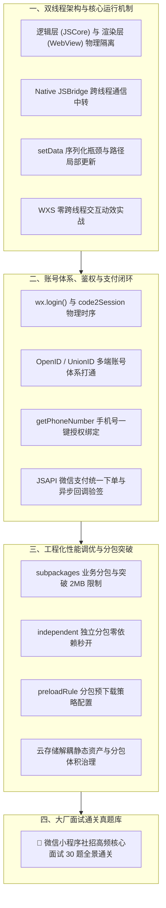

# 微信小程序全景技术图谱与实战前言

欢迎来到 **微信小程序工业级开发与高频面试专栏**。

作为国内移动互联网最普及的轻量级应用载体，微信小程序凭借“无需安装、触手可及、用完即走”的特性，承载了电商交易、政企服务、社交裂变等海量业务场景。

本专栏严格摒弃浮于表面的 API 罗列，直击小程序**双线程物理架构**、**setData 序列化通信调优**、**code2Session 登录鉴权闭环**、**分包突破 2MB 限制**、**微信支付防资损闭环**与大厂社招高频核心真题。

---

## 🗺️ 微信小程序工业级技术路线图

---

## 📚 专栏章节索引

### 一、双线程架构与核心运行机制
1. [01. 微信小程序双线程运行机制与 setData 性能调优 SOP](/doc/微信小程序/微信小程序双线程运行机制与setData性能调优SOP)
2. [02. 原生小程序基本开发与生命周期实战](/doc/微信小程序/原生小程序基本开发与面试)

### 二、账号体系、鉴权与支付闭环
3. [03. 微信小程序登录鉴权全流程：code2Session 与手机号一键授权闭环](/doc/微信小程序/微信小程序登录鉴权全流程code2Session与手机号一键授权闭环)
4. [04. 微信支付全流程前后端闭环：JSAPI 统一下单与回调验签实战](/doc/微信小程序/微信支付全流程前后端闭环统一下单与回调验签)

### 三、工程化性能调优与分包突破
5. [05. 微信小程序分包加载：subpackages、独立分包与分包预下载实战](/doc/微信小程序/微信小程序分包加载subpackages与独立分包及分包预下载实战)
6. [06. 微信小程序快速部署与全流程上架审核](/doc/微信小程序/微信小程序快速部署与上架审核)

### 四、大厂面试通关真题库
7. [07. 🎯 微信小程序社招高频核心面试 30 题全景通关](/doc/微信小程序/微信小程序社招高频核心面试30题通关)
