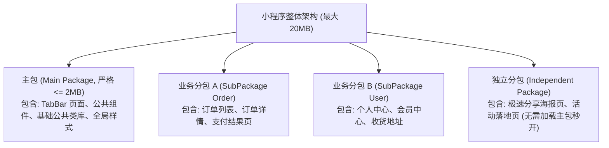

# 微信小程序分包加载：subpackages、独立分包与分包预下载实战

微信官方对小程序的体积有着严格的物理限制：**单个代码包体积不得超过 2MB，全量分包后总体积不得超过 20MB**。

当业务规模不断扩大、页面与静态资产迅速膨胀时，突破 2MB 限制并保证极速秒开（首屏加载耗时 < 1.5s）的关键技术就是**分包加载（Subpackages）**、**独立分包（Independent Subpackages）**与**分包预下载（PreloadRule）**。

---

## 1. 现代化分包目录架构与配置规范



### 1.1 `app.json` 生产级标准分包声明
```json
{
  "pages": [
    "pages/home/index",
    "pages/category/index"
  ],
  "subpackages": [
    {
      "root": "packageOrder",
      "name": "orderModule",
      "pages": [
        "pages/orderList/index",
        "pages/orderDetail/index"
      ]
    },
    {
      "root": "packageActivity",
      "name": "activityModule",
      "pages": [
        "pages/poster/index"
      ],
      "independent": true
    }
  ]
}
```

---

## 2. 独立分包（Independent Subpackages）的核心价值

通常情况下，打开任何一个普通分包页面，小程序客户端必须**先强制完整下载并运行主包代码**，然后再下载该分包。

### 适用场景：裂变分享海报与广告落地页
将分享给用户的活动落地页配置为 `"independent": true`：
- **零依赖秒开**：用户点击分享卡片进入时，客户端**完全不下载主包**，仅下载当前独立分包，首屏打开速度达到极限（300ms 级）；
- **限制约束**：独立分包不能依赖主包中的公共 JS 库、自定义组件和 `app.wxss` 样式；只有当用户从独立分包跳转到主包页面时，主包才会被懒加载。

---

## 3. 分包预下载（preloadRule）彻底消除跳转等待

为了防止用户在主包页面点击进入分包时出现“白屏菊花加载等待”，可以通过 `preloadRule` 策略在用户处于主包空闲期时，静默后台提前下载分包：

```json
{
  "preloadRule": {
    "pages/home/index": {
      "network": "all",
      "packages": ["packageOrder"]
    },
    "pages/category/index": {
      "network": "wifi",
      "packages": ["activityModule"]
    }
  }
}
```

- `"network": "all"`：在任何网络环境下，只要用户停留在 `pages/home/index`，即自动在后台悄悄预下载 `packageOrder`；
- `"network": "wifi"`：仅在连接 WiFi 时才预加载，节省用户移动网络流量。

---

## 4. 生产级包体积深度优化 SOP

1. **静态大图全部上云**：代码包内严禁放置超过 50KB 的本地图片，必须全部迁移至阿里云 OSS、腾讯云 COS 或 MinIO 对象存储，并通过 WebP 格式压缩；
2. **公共依赖下沉与重复打包排查**：分包引用的公共 JS 如果只在一个分包使用，务必移入分包内部；若在多个分包共用，必须提取到主包，避免同一份代码在多个分包中被重复打入产生冗余体积；
3. **开启微信开发者工具压缩优化**：在 `project.config.json` 中配置 `"minified": true` 与代码自动混淆。
