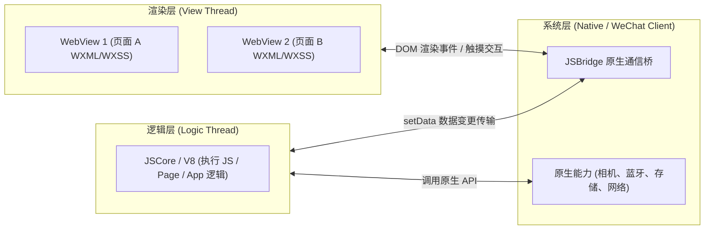
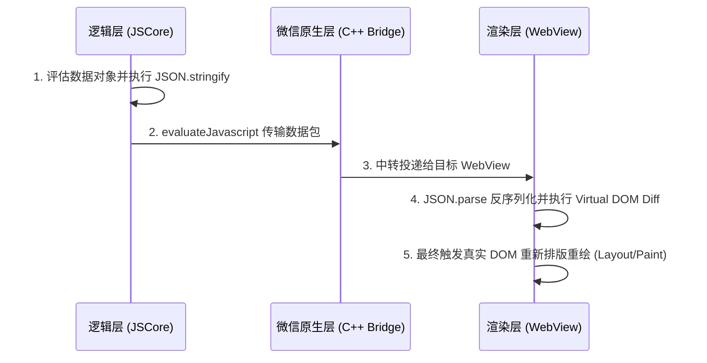

# 微信小程序双线程运行机制与 setData 性能调优 SOP

微信小程序的架构设计与传统的 Web 浏览器端渲染存在本质区别。为了杜绝恶意代码操纵 DOM、盗取敏感数据，微信团队设计了独创的**双线程架构（Dual-Thread Architecture）**。

深入理解双线程的通信物理壁垒、`setData` 的序列化瓶颈以及局部差量更新算法，是解决小程序滑动掉帧、输入卡顿等性能顽疾的必备技能。

---

## 1. 微信小程序双线程架构物理全景



### 核心物理特性
1. **渲染层与逻辑层彻底物理隔离**：
   - **逻辑层**：运行在独立的 JavaScript 引擎中（iOS 为 JavaScriptCore，Android 为 V8），**不存在任何 `window`、`document` 对象，完全无法直接通过 DOM API 操纵节点**；
   - **渲染层**：每一个小程序页面均由一个独立的 WebView 承载渲染，页面间的切换是多 WebView 栈管理。
2. **通信完全依赖 Native JSBridge 异步中转**：
   - 逻辑层与渲染层不能直接进行内存级共享对象传递，所有交互数据必须经过**序列化为 JSON 字符串 $\to$ 跨线程通过 Native 传递 $\to$ 渲染层反序列化并 Diff 挂载**。

---

## 2. setData 的物理链路与三大性能灾难

`setData` 是小程序中开发者调用最频繁的 API，也是性能杀手第一元凶：



### 性能灾难一：单次传输数据体积过大（Payload 膨胀）
若一次性将包含几百条商品大图、冗余描述字段的 List 塞入 `setData`（超过 1MB），会导致序列化耗时激增、Native 传输管道堵塞，产生明显的掉帧白屏。

### 性能灾难二：高频调用 setData（调用频次失控）
在页面滚动（`onPageScroll`）或定时器动画中，每秒调用数十次 `setData`，由于 JSBridge 具有队列饱和上限，后续的点击交互事件被压入队尾，引发严重的界面无响应与卡顿。

### 性能灾难三：未绑定的冗余后台数据挂载
将仅在逻辑计算中使用的内部变量（如计时器句柄、请求临时 Token）放在 `data` 中并随 `setData` 频繁发送，不仅浪费通信带宽，还会触发无意义的 DOM Diff。

---

## 3. 工业级 setData 性能调优 SOP

### 3.1 核心法则：利用路径表达式进行局部差量更新
严禁更新列表某个元素时重新 `setData` 整个数组：

```javascript
// ❌ 错误示范：重新发送整个列表（产生大量无谓序列化开销）
const list = this.data.orderList;
list[index].status = 'PAID';
this.setData({ orderList: list });

// ✅ 工业级优化：使用数据路径（Data Path）仅更新目标属性
this.setData({
  [`orderList[${index}].status`]: 'PAID'
});
```

### 3.2 滚动联动防抖与 WXS 零跨线程通信
对于高频滚动吸顶、水波纹跟随等交互动效，切忌在 `onPageScroll` 中调用 `setData`，应改用 **WXS（WeiXin Script）**：
WXS 代码直接运行在渲染层（WebView）内部，触摸手势和视图变换完全在渲染层闭环执行，**零线程切换、零 JSBridge 通信开销**，帧率直接拉满 60FPS。

```html
<!-- index.wxml -->
<wxs module="scrollHandler">
  function onScroll(event, ownerInstance) {
    var scrollTop = event.detail.scrollTop;
    var header = ownerInstance.selectComponent('#navHeader');
    if (scrollTop > 100) {
      header.setStyle({ opacity: 1 });
    } else {
      header.setStyle({ opacity: scrollTop / 100 });
    }
  }
  module.exports = { onScroll: onScroll };
</wxs>

<scroll-view scroll-y bindscroll="{{scrollHandler.onScroll}}">
  <!-- 列表内容 -->
</scroll-view>
```

---

## 4. 生产级调试与性能评分标准

1. **利用微信开发者工具 Performance 面板**：监控每秒 `setData` 调用频次（建议不超过 20次/秒）与单次传输数据包大小（建议控制在 256KB 以内）。
2. **纯数据字段（Pure Data Fields）声明**：
   在组件 options 中配置 `pureDataPattern: /^_/`，凡是以 `_` 开头的属性仅在 JS 逻辑层保留，绝不参与跨线程传输，大幅削减通信开销。
