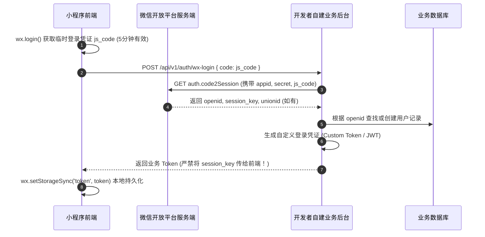

# 微信小程序登录鉴权全流程：code2Session 与手机号一键授权闭环

在微信小程序体系中，用户身份的鉴权与账户绑定是整个商业应用闭环的核心。微信官方为了防止用户隐私泄露，推行了基于 **OpenID / UnionID** 与 **code2Session** 的安全登录闭环体系。

本篇将系统剖析静默登录时序、自建 Session/JWT 维护机制、手机号快捷授权解密以及多端账号打通方案。

---

## 1. 微信静默登录与 code2Session 物理时序



### 核心参数物理意义
- **OpenID**：用户在当前特定小程序下的唯一标识。同一个用户在不同小程序下的 OpenID 完全不同；
- **UnionID**：用户在同一个微信开放平台账号绑定的多个应用（公众号、App、不同小程序）下的统一全局唯一标识。是实现**多端账号统一的核心主键**；
- **session_key**：微信服务端生成的对称加密密钥，用于对用户加密数据（如运动数据、旧版用户信息）进行 AES-128 解密。**绝对禁止泄漏至客户端前端**！

---

## 2. 手机号快捷一键授权获取实战（最新规范）

根据微信官方最新规范，获取手机号必须通过特定类型的按钮，由用户主动点击触发：

### 2.1 前端按钮与回调事件
```html
<button 
  open-type="getPhoneNumber" 
  bindgetphonenumber="onGetPhoneNumber">
  一键绑定手机号
</button>
```

```javascript
Page({
  async onGetPhoneNumber(e) {
    if (e.detail.errMsg === "getPhoneNumber:ok") {
      // 获取用于换取真实手机号的动态 code (单次有效)
      const phoneCode = e.detail.code;
      
      // 提交给业务后台由后端调用微信 API 解析
      const res = await wx.request({
        url: 'https://api.yourdomain.com/auth/bind-phone',
        method: 'POST',
        data: { code: phoneCode },
        header: { 'Authorization': `Bearer ${wx.getStorageSync('token')}` }
      });
      
      if (res.data.success) {
        wx.showToast({ title: '手机号绑定成功！' });
      }
    } else {
      wx.showToast({ title: '用户拒绝授权手机号', icon: 'none' });
    }
  }
});
```

### 2.2 后端服务端换取真实手机号（Node.js / Java 示例）
后端接收到 `phoneCode` 后，通过小程序的 `access_token` 调用微信接口 `https://api.weixin.qq.com/wxa/business/getuserphonenumber?access_token=ACCESS_TOKEN`，直接获取脱敏与纯数字手机号，彻底杜绝了前端篡改参数伪造他人身份的风险。

---

## 3. 生产级双 Token 无感刷新与会话保活

1. **登录凭证（Access Token）**：有效期通常设置为 2 小时；
2. **刷新凭证（Refresh Token）**：有效期设置为 14 天或 30 天，存入本地加密缓存；
3. **网络层自动拦截重试**：
   封装统一的 `request` 工具。当捕获到后端返回 `401 Unauthorized` 时，自动挂起当前失败的并发请求队列，调用后台刷新接口置换新 Token 后无感重发，用户完全察觉不到重新登录中断。

---

## 4. 面试高频深度答疑

| 考点问题 | 核心答题要点 |
| :--- | :--- |
| **为什么 session_key 不能暴露给小程序前端？** | `session_key` 拥有对该用户在当前小程序加密数据的解密权，一旦泄露，中间人可伪造用户签名，发起重放攻击或盗取用户手机号与资产。 |
| **跨小程序如何识别是同一个用户？** | 前提条件是小程序必须绑定在同一个微信开放平台账号下；通过 `auth.code2Session` 或用户授权获取统一的 `UnionID` 作为全域唯一识别标识。 |
| **wx.checkSession 的作用是什么？** | 用于在前端静默检测微信服务端当前缓存的登录态（session_key）是否过期，避免每次进入小程序都盲目调用耗时的 `wx.login()`。 |
