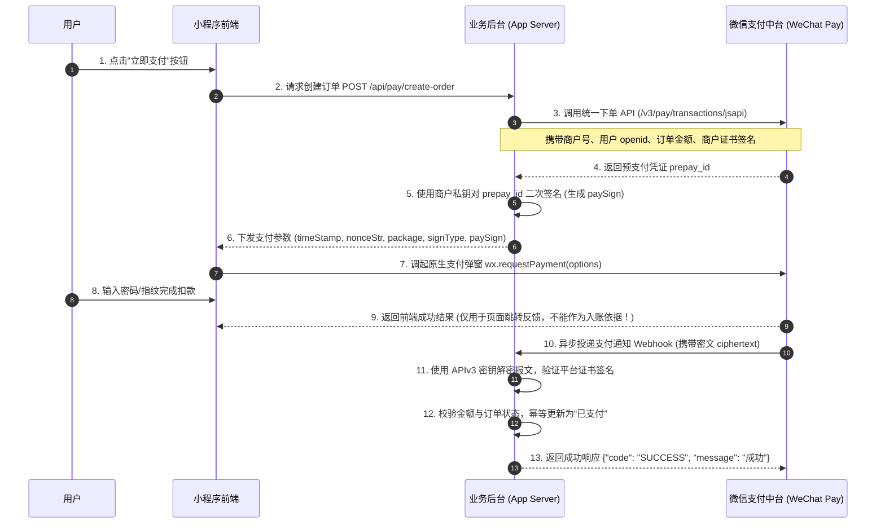

# 微信支付全流程前后端闭环：JSAPI 统一下单与回调验签实战

微信支付（JSAPI 支付）是微信生态内最核心的商业变现通道。支付涉及企业资金安全，任何一个环节的签名漏洞、参数篡改或未做幂等处理，都可能引发严重的经济损失或资损漏洞。

本篇将系统剖析小程序端发起支付到后端统一下单、异步 Webhook 回调验签、防重复入账幂等处理的完整闭环流程。

---

## 1. 微信支付全时序物理流转图（V3 协议标准）



---

## 2. 小程序前端调起原生支付弹窗

前端接收到服务端下发的二次签名参数后，调用 `wx.requestPayment` 原生 API：

```javascript
// 小程序前端支付封装
async function handlePay(orderId) {
  wx.showLoading({ title: '创建支付中...' });
  try {
    // 1. 请求后端统一下单，获取二次签名参数
    const res = await api.createPayment({ orderId });
    wx.hideLoading();

    const { timeStamp, nonceStr, packageVal, signType, paySign } = res.data;

    // 2. 唤起微信原生收银台
    wx.requestPayment({
      timeStamp,
      nonceStr,
      package: packageVal, // 形如: "prepay_id=wx20261117..."
      signType: signType || 'RSA',
      paySign,
      success(payRes) {
        // 仅作为前端展示引导，订单真实状态需轮询或由后端驱动
        wx.navigateTo({ url: `/pages/payResult/index?orderId=${orderId}&status=success` });
      },
      fail(err) {
        if (err.errMsg.indexOf('cancel') > -1) {
          wx.showToast({ title: '用户取消支付', icon: 'none' });
        } else {
          wx.showToast({ title: '支付失败，请重试', icon: 'error' });
        }
      }
    });
  } catch (e) {
    wx.hideLoading();
    wx.showToast({ title: e.message || '网络异常', icon: 'none' });
  }
}
```

---

## 3. 服务端异步回调安全防护与幂等性治理

微信支付服务端通过 HTTPS POST 向商户后台发送异步通知。这是**唯一权威的入账凭据**。

### 3.1 核心防护一：微信平台公钥验签与密文解密（防伪造请求）
后端在收到 Webhook 时，必须：
1. 读取请求头中的 `Wechatpay-Signature`、`Wechatpay-Timestamp`、`Wechatpay-Nonce` 与证书序列号；
2. 使用**微信平台公钥证书**对整个报文体进行 SHA256withRSA 验签，严防黑客伪造支付成功请求；
3. 验签通过后，使用商户后台配置的 **APIv3 密钥（AES-256-GCM）** 对 `ciphertext` 密文进行解密，提取真实商户订单号 `out_trade_no` 与金额 `total_amount`。

### 3.2 核心防护二：防重复投递幂等更新（防重复发货/多次充值）
由于网络抖动或商户响应超时，微信支付可能在 24 小时内向商户重复重试推送多次通知（如 15s/15s/30s/3m...）：
- **状态机悲观锁控制**：
  ```sql
  -- 使用更新语句的行锁与前置条件保证幂等
  UPDATE t_order 
  SET order_status = 'PAID', paid_time = NOW() 
  WHERE order_id = 'ORD_20261117001' AND order_status = 'UNPAID';
  ```
- 若受影响行数等于 1，说明是首次通知，执行增加库存、发放权益与写入流水；
- 若受影响行数等于 0，说明该订单已被处理过，**直接返回 200 SUCCESS 终止微信重试**。
