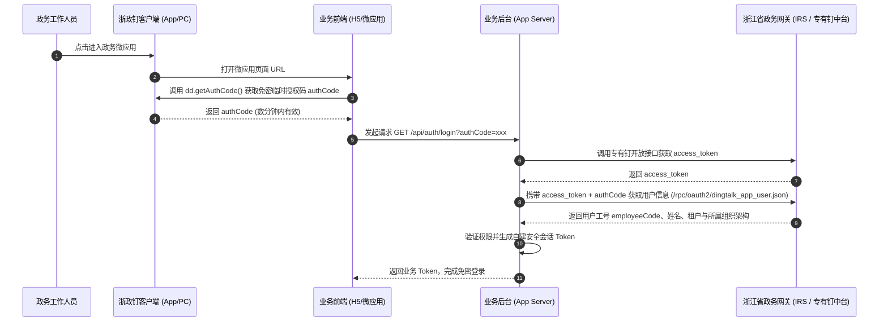

# 浙政钉单点登录免密鉴权与专有钉钉网关联调实战

在政务数字化转型与政企协同领域，**浙政钉（专有钉钉 / 专有移动办公平台）** 是浙江省数字化改革的重要基础设施。

由于政务系统对信息安全、权限控制和网络隔离有着极高要求，浙政钉的应用鉴权与商业版普通钉钉或微信完全不同。本篇将系统剖析**浙政钉单点登录（SSO）免密鉴权全链路**、**IRS 统一网关中转调用**以及**专有政务网络环境联调 SOP**。

---

## 1. 浙政钉单点登录（SSO）物理时序



---

## 2. 前端 JSAPI 免密授权码获取标准实现

在浙政钉环境中，必须引入官方专有的 JSAPI 库（`gdt-jsapi`）：

```javascript
import dd from 'gdt-jsapi';

// 获取浙政钉免密授权码
export async function getZzdAuthCode(corpId) {
  return new Promise((resolve, reject) => {
    dd.ready(() => {
      dd.getAuthCode({
        corpId: corpId // 专有钉钉租户/政务机构唯一标识
      }).then(res => {
        if (res && res.code) {
          resolve(res.code);
        } else {
          reject(new Error('获取浙政钉 authCode 失败'));
        }
      }).catch(err => {
        reject(err);
      });
    });
  });
}
```

---

## 3. 政务网络与 IRS 网关核心避坑要点

1. **IP 白名单与政务电子政务外网隔离**：
   - 业务后台服务器访问浙政钉 OpenAPI 或 IRS 接口，必须提前在控制台报备服务器公网出口 IP，未经配置的 IP 发起请求会直接收到 `403 Forbidden`；
   - 生产环境通常需要通过政务外网（专用专线）或前置安全反向代理服务器进行流量中转。
2. **多租户隔离与权限范围（Tenant Isolation）**：
   - 浙政钉按地域和层级（省本级、市级、区县级）严格划分租户（tenantId）。服务端在处理人员数据时，必须校验当前登录人是否具备目标租户的数据访问权限，严防越权越级操作。
