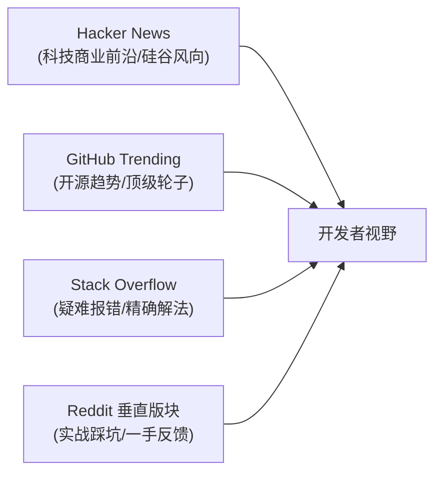
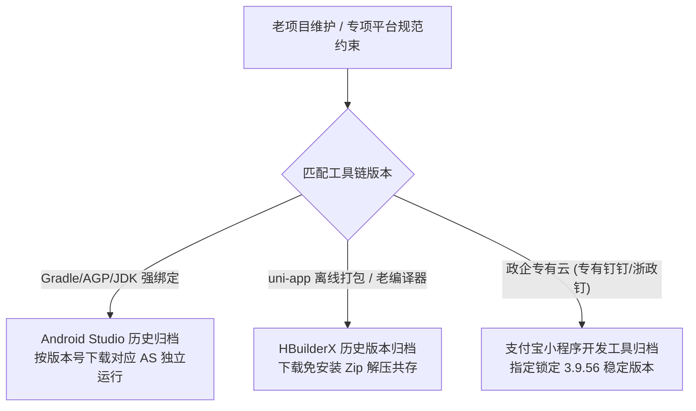

# 第三方论坛与优质技术社区导航

在全栈开发与工程进阶的过程中，闭门造车往往容易陷入“信息茧房”或重复踩坑。一个优秀的开发者不仅需要扎实的基础原理，更需要敏锐的技术嗅觉和高效的外部交流渠道。

本清单系统性整理了当前海内外**活跃度最高、信息质量最过硬、技术前沿度最敏锐**的第三方极客论坛、垂直技术社区、大厂工程博客与权威周刊，助力拓宽技术视野、排查疑难杂症与捕捉前沿技术红利。

---

## 1. 极客热榜与高活跃度综合社区

此类论坛聚集了海量极客、独立开发者、全栈工程师与海外从业者，内容不仅涵盖代码本身，更包含**前沿 AI 生产力、基础设施（VPS/网络）、职场机会与技术变现**。

| 社区名称 | 访问地址 | 核心定位与特色优势 | 推荐常驻板块 / 重点关注 |
| :--- | :--- | :--- | :--- |
| **LINUX DO** | [linux.do](https://linux.do/) | • **现象级新一代极客论坛**（基于 Discourse 构建，氛围友善活跃）<br>• 大模型逆向、AI API 转接中转、Prompt 调优与最新大模型实操<br>• 云服务器（VPS）测速、网络调优、建站脚本与开源项目首发<br>• 独特的信任级别（TL1~TL3）积分防刷与真诚交流文化 | `人工智能`、`开发调优`、`福利羊毛`、`资源荟萃`、`运营反馈` |
| **V2EX** | [v2ex.com](https://www.v2ex.com/) | • **老牌独立开发者与极客大本营**，极简 Markdown 原生设计<br>• 真实客观的技术选型讨论、互联网大厂/外企职场生存现状<br>• 独立产品 “分享创造” 孵化地、全职/远程/海外高薪招聘首发地 | `程序员`、`酷工作 (招聘)`、`分享创造`、`问与答`、`Apple` |
| **NodeSeek** | [nodeseek.com](https://www.nodeseek.com/) | • **极客 VPS、网络线路与轻量级云原生**深度评测社区<br>• 服务器网络路由（BGP/CN2 GIA/AS9929）、CDN 穿透与抗投诉实战<br>• 个人自建服务器、私有云存储、家庭 Lab（Homelab）折腾指南 | `VPS 与云服务`、`网络技术`、`技术讨论`、`交易市场` |
| **吾爱破解 (52Pojie)** | [52pojie.cn](https://www.52pojie.cn/) | • 国内顶级**逆向工程、二进制安全与软件调试**技术论坛<br>• 极深水区的 Android APK 反编译、脱壳、Hook（Frida/Xposed）分析<br>• 网络安全协议分析、底层加固与免杀逆向攻防思路 | `Android 安全`、`脱壳逆向`、`原创安全区`、`安全工具` |
| **Hostloc (全球主机交流)** | [hostloc.com](https://hostloc.com/) | • 老牌站长圈与低级基础设施论坛，业内俗称“落伍者”<br>• 各大海外主机商低价促销一手情报、域名交易与建站攻防经验 | `全球主机交流`、`站长交流` |

---

## 2. 国际顶尖技术论坛与代码交流

全球软件工程标准与前沿发源地，建议常态化关注以保持英文技术阅读敏感度。



| 平台名称 | 访问地址 | 核心价值与高阶用法 |
| :--- | :--- | :--- |
| **Hacker News (YC)** | [news.ycombinator.com](https://news.ycombinator.com/) | Y Combinator 孵化器运营的全球顶级极客智库。评论区往往有顶尖开源作者、图灵奖得主或硅谷核心架构师亲自答疑。极佳的技术敏锐度风向标。 |
| **GitHub Trending** | [github.com/trending](https://github.com/trending) | 开源社区晴雨表。按每日（Today）、每周（This week）查看全语言或指定技术栈（Kotlin/Vue/Java/Python）爆火项目，掌握造轮子与选型趋势。 |
| **Stack Overflow** | [stackoverflow.com](https://stackoverflow.com/) | 全球权威技术报错百科。善用 `[tag]` 精准过滤（如 `[android] [kotlin-coroutines]` 或 `[spring-boot] [transactional]`），高赞回答往往深入源码底层机制。 |
| **Reddit (Tech Subreddits)** | [reddit.com/r/programming](https://www.reddit.com/r/programming/) | 全球最大泛兴趣社区中的硬核技术阵地。常用子版块推荐：<br>• `r/androiddev`：Google 工程师常驻，第一时间了解 API 废弃与 Gradle 变动<br>• `r/vuejs` & `r/reactjs`：前端框架生态一手探讨<br>• `r/LocalLLaMA`：开源大模型本地量化、推理部署与微调第一站<br>• `r/selfhosted`：自建服务与 Docker 实用工具指南 |
| **Lobsters** | [lobste.rs](https://lobste.rs/) | 纯粹的邀请制底层技术链接聚合社区，严格禁止软文和水贴，深度聚焦系统编程、分布式架构与语言设计。 |
| **Dev.to** | [dev.to](https://dev.to/) | 氛围轻快、注重实用技巧的国际开源开发者社区，新手入门与最佳工程实践丰富。 |

---

## 3. 国内一线主流技术社区与博客专栏

针对中文业务场景、技术进阶与国产云生态的最佳实战沉淀阵地：

| 平台名称 | 访问地址 | 核心特色与适用场景 |
| :--- | :--- | :--- |
| **稀土掘金** | [juejin.cn](https://juejin.cn/) | 大前端（Vue/React）、Android 及 Java 领域国内活跃度最高的现代技术社区，大量一线技术专家分享架构设计、实战复盘与技术进阶指南。 |
| **思否 (SegmentFault)** | [segmentfault.com](https://segmentfault.com/) | 专注开发者技术问答、开源专栏与技术沙龙活动，Web 全栈及开源项目解答质量扎实。 |
| **博客园 (CNBlogs)** | [cnblogs.com](https://www.cnblogs.com/) | 国内老牌技术写作聚集地，沉淀了大量关于底层算法、.NET/Java 源码分析、设计模式与工业级实战的长篇原创深度好文。 |
| **开源中国 (OSCHINA)** | [oschina.net](https://www.oschina.net/) | 国产开源项目宣发、开源动态快讯与技术沙龙第一站，Gitee 官方社区。 |
| **InfoQ 中国** | [infoq.cn](https://www.infoq.cn/) | 偏向架构师、技术总监与资深工程师的深度技术资讯平台，QCon、ArchSummit 顶会干货 PPT 与大厂系统架构演进报告集合地。 |

---

## 4. 国内大厂工程技术团队博客（必读生产级方案）

想要了解千万级、亿级流量下的真实架构演进、宕机复盘与稳定性保障，直接研读头部大厂的官方技术博客是最高效的途径：

```
顶级大厂技术博文
├── 美团技术团队博客 (业界公认工程标杆: MySQL/高并发/JVM/分布式事务)
├── 阿里技术 (云原生/微服务中间件/双11高可用保障体系)
├── 字节跳动技术团队 (音视频编解码/超大单体多仓构建/移动端APM性能监控)
├── 腾讯技术工程 (Tencent TEG: 基础网络协议优化/分布式存储/内核排障)
└── 百度技术团队 (大规模AI训练集群/大模型检索增强/百亿级搜索架构)
```

- **[美团技术团队博客](https://tech.meituan.com/)**（⭐ 强烈推荐）：国内质量最高的技术博客之一。例如《美团点评JVM调优实战》、《Leaf——美团分布式ID生成系统》、《MySQL索引原理与慢查询优化》，是技术深挖与架构学习的宝库。
- **[阿里技术官方专栏](https://developer.aliyun.com/article/)**：涵盖 Spring Boot/Cloud 生产落地、Dubbo/RocketMQ 源码剖析、高并发熔断限流实战。
- **[字节跳动技术团队](https://juejin.cn/user/1565318510523624)**：分享移动端端智能、跨端架构演进、Webpack/Vite 极速编译、海量日志排查体系。
- **[腾讯技术工程 (TEG)](https://cloud.tencent.com/developer/column/1183)**：涵盖 Linux 内核网络栈、K8s 容器编排万级节点优化、自研存储底座。

---

## 5. 权威技术周刊与信息聚合（拒绝信息过载）

日常开发工作繁重，无需每天逐一刷论坛。订阅高质量**技术周刊**，每周只需 30 分钟即可完成技术栈迭代扫描：

1. **综合与科技文化**：
   - **[阮一峰《科技爱好者周刊》](https://www.ruanyifeng.com/blog/)**：每周五准时更新，汇集国内外优质科技资讯、好用的小工具、开源新库与技术观察。
   - **[HelloGitHub 推荐周刊](https://hellogithub.com/)**：每月推荐有趣、好玩、入门级的开源项目，涵盖全编程语言。
2. **移动端垂直**：
   - **[Android Weekly (英文)](https://androidweekly.net/)**：全球最具影响力的 Android 技术周刊，覆盖官方最新动态、Compose 进阶与架构方案。
   - **[Android Weekly 优质中文精选](https://androidweekly.cn/)**：国内 Android 社区专家协作翻译整理的一线文章。
3. **前端与全栈**：
   - **[JavaScript Weekly](https://javascriptweekly.com/)**：全球前端行业标准周刊，JS 引擎改动、新特性提案一网打尽。
   - **[奇舞周刊 (360前端)](https://weekly.75.team/)**：国内老牌前端团队周报，聚焦 Web 原生能力、CSS 新规范与工程化实践。
4. **后端与 Java**：
   - **[Java Annotated Monthly (JetBrains 官方)](https://blog.jetbrains.com/idea/tag/annotated-monthly/)**：IntelliJ IDEA 团队精心整理的每月 Java、Kotlin 与服务端生态精选。
   - **[Baeldung Weekly](https://www.baeldung.com/)**：Java 与 Spring 领域最为详尽的示例代码与更新速递。

---

## 6. 社区参与礼仪与高价值交流指南

无论是访问 **LINUX DO**、**V2EX** 还是 **Stack Overflow**，掌握高效的社区交流规范不仅能更快获得高质量解答，还能树立良好的技术个人品牌：

> [!TIP] 提问的核心原则：提供“最小可复现示例 (Minimal Reproducible Example)”
> 1. **说明环境**：操作系统、语言版本、依赖库具体版本号（例如：`Kotlin 1.9.20 + AGP 8.2 + Compose 1.6`）。
> 2. **描述预期与现状**：预期表现是什么，实际输出了什么报错（附带完整异常堆栈，避免直接发手机拍屏幕的照片）。
> 3. **写明已尝试过的方案**：告知大家你已经排除了哪些方向，节约双方沟通成本。

### 常用极客社区实用技巧
- **LINUX DO 社区升级**：遵循 Discourse 机制，多阅读长帖、点赞优质回答、保持活跃天数，自然提升 Trust Level（TL1/TL2/TL3），解锁更多高阶资源节点权限。
- **V2EX 发帖注意事项**：发帖选择正确的 Node 节点（如 `share` 节点用于发布自己的作品，`create` 用于头脑风暴，`jobs` 严格按格式发布招聘信息），遵循社区规范避免无效水贴。
- **RSS 聚合阅读**：推荐配合 **Follow**、**Inoreader** 或 **Miniflux**，将上述论坛的精选板块 RSS 源聚合到一个客户端，告别算法推荐杂讯，实现沉浸式极客阅读。

---

## 7. 跨端主流框架生态与核心仓库地址（Flutter & uni-app）

对于进行跨端（Cross-Platform）应用与小程序开发的同学，以下汇总了 **Flutter** 与 **uni-app** 官方核心仓库、生态中枢及业界标杆开源项目：

### ① Flutter 官方主仓与业界生态

| 资源定位 | 项目 / 资源名称 | 访问地址 | 说明与核心价值 |
| :--- | :--- | :--- | :--- |
| **官方主仓库** | **Flutter Framework** | [github.com/flutter/flutter](https://github.com/flutter/flutter) | Google 官方主仓库，Dart 语言层全套组件与渲染管线逻辑 |
| **底层核心引擎** | **Flutter Engine** | [github.com/flutter/engine](https://github.com/flutter/engine) | C++ 编写的底层自绘核心，驱动 Skia / Impeller 与各操作系统 Host 桥接 |
| **官方中文网** | **Flutter 中文社区** | [flutter.cn](https://flutter.cn/) | 官方中文文档、Codelabs 教程与国内镜像配置指导 |
| **包管理中心** | **Pub.dev** | [pub.dev](https://pub.dev/) | 官方 Dart & Flutter 包管理器中心，查看插件热度与评分 |
| **网络请求** | **Dio** | [github.com/cfug/dio](https://github.com/cfug/dio) | 工业级网络请求库（拦截器、文件上传、统一超时与取消） |
| **状态管理** | **Bloc / Riverpod** | [github.com/felangel/bloc](https://github.com/felangel/bloc) | 业界主流严格单向数据流架构与编译期类型安全状态库 |
| **高性能存储** | **Tencent MMKV** | [github.com/Tencent/MMKV](https://github.com/Tencent/MMKV) | 基于 mmap 内存映射的高性能键值缓存，替代 SP/SQLite 首选 |
| **业界标杆开源 App** | **AppFlowy** | [github.com/AppFlowy-IO/AppFlowy](https://github.com/AppFlowy-IO/AppFlowy) | 数万 Star 开源版 Notion，Flutter + Rust 顶尖桌面与跨端架构典范 |
| **业界标杆开源 App** | **RustDesk** | [github.com/rustdesk/rustdesk](https://github.com/rustdesk/rustdesk) | 远程桌面客户端（Flutter UI 深度实战与高性能通讯） |

### ② uni-app 官方主仓与业界生态

| 资源定位 | 项目 / 资源名称 | 访问地址 | 说明与核心价值 |
| :--- | :--- | :--- | :--- |
| **官方主仓库** | **uni-app** | [github.com/dcloudio/uni-app](https://github.com/dcloudio/uni-app) | DCloud 官方主仓，Vue 2/Vue 3 多端编译器及 App/小程序/Web 运行时 |
| **新一代原生引擎** | **uni-app x** | [github.com/dcloudio/uni-app-x](https://github.com/dcloudio/uni-app-x) | 采用 UTS 语言直译为 Kotlin/Swift 原生代码的下一代高性能跨端引擎 |
| **官方基础组件** | **uni-ui** | [github.com/dcloudio/uni-ui](https://github.com/dcloudio/uni-ui) | DCloud 官方基础组件库，全面兼容全平台多端小程序与 App |
| **官方文档中心** | **uni-app 官网** | [uniapp.dcloud.net.cn](https://uniapp.dcloud.net.cn/) | 官方框架规范、多端兼容性指南与 API 参考手册 |
| **插件生态市场** | **DCloud 插件市场** | [ext.dcloud.net.cn](https://ext.dcloud.net.cn/) | 上万款开箱即用原生插件、页面模版、SDK 与云函数市场 |
| **云开发体系** | **uniCloud** | [doc.dcloud.net.cn/uniCloud](https://doc.dcloud.net.cn/uniCloud/) | 前端一体化 Serverless 云函数、云数据库与统一鉴权中心 |
| **主流 UI 组件库** | **uView Plus** | [github.com/ijry/uview-plus](https://github.com/ijry/uview-plus) | 全网使用率最高的 uni-app 组件库，深度适配 Vue 3 与全端多场景 |
| **高颜值现代化 UI** | **Wot Design Uni** | [github.com/Moonofweisheng/wot-design-uni](https://github.com/Moonofweisheng/wot-design-uni) | 基于 Vue 3 + TS 打造的高颜值、轻量级现代化移动端跨端组件库 |
| **超火开箱模版框架** | **unibest** | [unibest.tech](https://unibest.tech/) / [GitHub](https://github.com/codercup/unibest) | **最好用的 uni-app 现代化开发模板**（Vite + Vue3 + TS + UnoCSS + Pinia + 自动路由 + 请求封装 + CI/CD） |
| **现代工程化脚手架** | **Uni Helper** | [github.com/uni-helper/vitesse-uni-app](https://github.com/uni-helper/vitesse-uni-app) | 基于 Vite + TypeScript + UnoCSS + Pinia 现代化小程序工程化模板 |

---

## 8. Vibe Coding 与 Agentic AI 前沿生态资源（MCP 与 Skills）

当下最前沿的 AI 编程（Vibe Coding）与智能体协同工具链及官方资源：

| 平台 / 工具名称 | 官方/开源地址 | 核心类别 | 核心功能与使用价值 |
| :--- | :--- | :--- | :--- |
| **UI/UX Pro Max** | [uupm.cc](https://uupm.cc/) / [GitHub](https://github.com/nextlevelbuilder/ui-ux-pro-max-skill) | **设计智能 Skill** | 为 AI Coding Agent 注入专业设计系统、配色推荐与 Tailwind 布局智能，拒绝廉价 AI UI |
| **Google Stitch** | [stitch.withgoogle.com](https://stitch.withgoogle.com/) | **AI 原生设计画布** | Google Labs 推出的高保真 AI 原生设计工具，支持对话/画布秒级生成界面与 `DESIGN.md` |
| **Stitch MCP** | [Stitch MCP 协议](https://github.com/google) | **设计直通代码 MCP** | 建立 Stitch 画布与 Claude Code/Antigravity/Cursor 实时通道，设计稿直通前端组件 |
| **Superpowers** | [github.com/obra/superpowers](https://github.com/obra/superpowers) | **研发工程纪律框架** | 资深工程师 Jesse Vincent 打造的 Agent 规训系统（头脑风暴、强制 TDD、根因排障） |
| **Trellis** | [github.com/mindfold-ai/trellis](https://github.com/mindfold-ai/trellis) | **工作区记忆与规约** | 解决 Vibe Coding 会话失忆与上下文漂移，提供 `.trellis/` 架构契约与任务追踪 |
| **CC-Switch** | [ccswitch.io](https://ccswitch.io/) / [GitHub](https://github.com/farion1231/cc-switch) | **多模型与网关切换** | Claude Code / Codex 多供应商（官方/中转/DeepSeek）、多账号与本地网关一键切换神器 |
| **Model Context Protocol** | [modelcontextprotocol.io](https://modelcontextprotocol.io/) | **MCP 官方标准** | Anthropic 推出的跨应用大模型上下文与工具互通开放协议，连接本地终端与外部 API |
| **MCP Market / Pulse** | [mcpmarket.com](https://mcpmarket.com/) | **MCP 市场与聚合** | 全球社区最活跃的开源 MCP 服务器与插件发现平台 |

---

## 9. 开发者核心 IDE 与多端构建工具历史版本归档 (Archive)

在企业级交付与老旧项目维护中，“新版本工具链跑不通老代码”是高频痛点。升级 IDE 往往会同步引发 Gradle、AGP、JDK、编译器或打包插件的雪崩式不兼容。因此，**收藏官方历史版本下载通道、按需版本锁死（Version Pinning）** 是每一位移动端与全栈开发者的必备护城河。



### 核心历史版本归档矩阵

| 工具 / 平台名称 | 官方历史版本归档地址 | 核心应用场景与兼容避坑指南 |
| :--- | :--- | :--- |
| **Android Studio 历史版本归档** | [developer.android.com/studio/archive](https://developer.android.com/studio/archive) | • **老项目兼容救命通道**：维护 3~5 年前老项目时，由于 Gradle 3.x/4.x、老版 AGP（Android Gradle Plugin）与老版本 JDK 强绑定，直接在最新 AS 上极难甚至无法完成 Gradle Sync。<br>• **多版本共存技巧**：从归档页下载对应版本 `.zip` 解压至独立目录，配合专用 JDK 独立启动，避免篡改全局配置。<br>• 涵盖从 Android Studio 1.0 到最新正式版/Canary 版的全量历史镜像与变更日志。 |
| **HBuilderX 历史版本归档** | [hx.dcloud.net.cn/Tutorial/HistoryVersion](https://hx.dcloud.net.cn/Tutorial/HistoryVersion) | • **uni-app 跨端开发回退**：不同版本的 HBuilderX 内置了不同版本的 node、uniapp 编译器与 UTS 运行期环境。<br>• 当新版更新引入新 Bug、或老项目依赖的特定离线 SDK（如特定版本 App 离线打包 SDK）发生变动时，可直接通过该通道下载对应的 Windows / Mac 历史安装包。<br>• 包含 Alpha（体验版）与 Release（正式版）各阶段版本安装包及详细更新日志。 |
| **支付宝小程序开发工具 (IDE)** | [opendocs.alipay.com/mini/ide/stable_log](https://opendocs.alipay.com/mini/ide/stable_log?pathHash=e4b6a05a) | • **政企专有端强版本约束**：专有钉钉、浙政钉等政企小程序生态基于阿里 mPaaS 定制架构开发。<br>• **当前强制指定版本**：浙政钉开发目前实测推荐并指定使用 **`3.9.56 (3.9.56)`**。<br>• 早期官方文档推荐的 `2.3.4` 在 uni-app 编译导入后会永久卡在“编译中”；过新的最新版则可能遇到专有钉钉环境插件校验报错或真机上传白屏。请务必使用该历史页面下载安装 `3.9.56` 稳定版。 |

::: tip 多 IDE 版本共存与本地管理实践
1. **Mac 平台重命名共存**：下载历史版本 `.dmg` 或压缩包解压后，建议重命名为 `Android Studio Ladybug.app`、`Android Studio Chipmunk.app` 或 `HBuilderX-3.8.12.app` 并拖入 `/Applications`，各版本之间配置目录互不干扰。
2. **专有钉钉配置切忌全局覆盖**：使用支付宝小程序开发工具（版本 3.9.56）导入专有钉钉 `config.dg-work.json` 配置文件后，建议保留一份离线备份，并在 IDE 切换环境或多账号登录失败时及时重启 IDE。
:::
